# KOREAN-tokenizer

**Does splitting Hangul into Jamo (한 → ㅎ + ㅏ + ㄴ) help a tokenizer?**

> [!IMPORTANT]
> **Not for token count: it is close to a tie.**
> Jamo used **1.5% fewer** tokens in our test, and **2% fewer to 5% more** in two independent tests.

| | Question | Answer |
|:-:|:--|:--|
| ➖ | Fewer tokens? | **About the same.** |
| ✅ | Same cost for NFC and NFD text? | **Yes, but not unique to Jamo.** An ordinary Unicode normalizer does it too. |
| ✅ | No raw bytes for rare syllables? | **Yes, but rarely needed:** 57 of 9.1 million syllables in our test. |
| ❓ | A better language model? | **Not measured here.** |

<sub>NFC stores 한 as one character. NFD stores it as three. They look identical on screen.</sub>

> [!NOTE]
> **Corrections (2026-11-25)**
> - The proposal's claims of "half" the tokens, "close to parity" with English, and "cost-free" were never measured and are **retracted**.
> - This README also said the `nmt_nfkc` control compresses better than Jamo. Line breaks had been counted unequally; [fixed below](#our-test).
>
> A paused personal side project by a non-expert, built with AI assistance. A reference, not validated research.

**Discussion:** [huggingface/tokenizers#1975](https://github.com/huggingface/tokenizers/issues/1975) · [openai/tiktoken#511](https://github.com/openai/tiktoken/issues/511) · [google/sentencepiece#1197](https://github.com/google/sentencepiece/issues/1197) (Jamo mapping merged in [#1200](https://github.com/google/sentencepiece/pull/1200))

## Token count

| Test | Jamo vs. raw | Tokenizer, vocabulary |
|:--|--:|:--|
| This repository | 🔽 −1.5% | SentencePiece BPE, 32K |
| [Biruk-gebru](https://github.com/huggingface/tokenizers/issues/1975#issuecomment-7097208735) ([data](https://github.com/Biruk-gebru/amharicTokenizer/blob/c96e609e481322e87b91e9db5c030dbb947832ff/measurement/data/robustness_results_ko.json)) | 🔽 −2.0% | Unigram, 32K |
| Biruk-gebru | 🔺 +1.2% | character BPE, 32K |
| Biruk-gebru | 🔺 +1.7% | byte-level BPE, 32K |
| Biruk-gebru | 🔺 +5.3% | byte-level BPE, 4K |
| [MonikaDvorackova](https://github.com/openai/tiktoken/issues/511#issuecomment-6743473646) | 🔺 +1.7% | byte-level BPE, 2,323 |

<sub>🔽 fewer tokens · 🔺 more tokens. All Korean. Corpora and trainers differ, so compare directions, not exact values. Biruk-gebru trained on about 1.2M characters and used compatibility Jamo (ㄱ); this repository uses conjoining Jamo (ᄀ).</sub>

**Why a tie?** BPE puts the pieces back together:

```text
한국  →  ㅎ ㅏ ㄴ ㄱ ㅜ ㄱ  →  [한국]
         split               merged again
```

With Jamo, pieces covering two or more whole syllables went **up**, from 57% to 67% of our 32K vocabulary.

## Our test

Same Korean Wikipedia text, same SentencePiece 0.2.2 BPE, same 32K vocabulary. Only the text normalization differs.

| | Baseline | `nmt_nfkc` control | Jamo |
|:--|--:|--:|--:|
| Held-out tokens | 7,124,970 | 7,107,482 | **7,015,058** |
| vs. baseline | – | −0.25% | **−1.54%** |
| NFD ÷ NFC tokens | 7.29× | **1.00×** | **1.00×** |
| Byte tokens per rare syllable | 3.00 | 3.00 | **0.00** |

- **Counted line by line.** The earlier numbers (7,449,254 / 7,107,482 / 7,339,458) joined lines with a line break, which cost baseline and Jamo one token each and `nmt_nfkc` none.
- **Rare syllable** means at most five occurrences in training: 50 types, 57 held-out occurrences.
- **Limits.** One run, Wikipedia only, training and test from the same source.

## How Hangul composes

```text
19 initials × 21 vowels × 28 finals (27 + none) = 11,172 syllables

ᄒ + ᅡ + ᆫ = 한
```

<details>
<summary><b>Animated diagram</b></summary>

<p align="center">
  
</p>

</details>

## Hypothesis and evidence

> **Hypothesis.** If Korean had as much training data as English, a model trained on Jamo from the start, inside its embeddings and not only in the tokenizer, would handle Korean meaningfully better, especially where text meets speech: text-to-speech (TTS) and speech recognition (ASR).

**This is the question the project started from. It is not tested here**, and no study found so far tests all of it.

```text
Tested above      ㅎㅏㄴㄱㅜㄱ → [한국]
                  the model sees one vector

The hypothesis    [한국] + (ㅎ ㅏ ㄴ ㄱ ㅜ ㄱ)
                  the model sees the Jamo too
```

### Why it might hold

| Reason | Example |
|:--|:--|
| Letters stand for sounds | ㅎ + ㅏ + ㄴ → 한 |
| Spelling keeps the stem while the sound changes by rule | 읽다 [익따] · 읽는 [잉는] · 읽어 [일거] |
| Grammar sits in the final letter | 간 (went) · 갈 (will go) · 감 (going) |

### What published work shows

| | Area | Result |
|:-:|:--|:--|
| 🟢 | Text model, from scratch | [KOMBO](https://aclanthology.org/2024.findings-acl.302/): +2.11% on average over the previous best on 5 tasks. Below BERT on 3 of 9 tasks in SCRIPT's comparison. |
| 🟢 | Text model, Jamo added | [SCRIPT](https://aclanthology.org/2026.findings-acl.104/): average gains of up to 1.6%p on understanding tasks, at about 100M to 2.4B parameters. |
| 🟢 | ASR, little data (50 h) | [K-Wav2vec](https://arxiv.org/abs/2110.05172): character error Jamo **6.60** vs. syllable 6.82. Both together: **6.41**. |
| 🟡 | ASR, more data (965 h) | [K-Wav2vec](https://arxiv.org/abs/2110.05172): with sound-based transcripts, Jamo 7.31 vs. syllable 6.96, both together **6.88**. With standard spelling, syllable alone was best (**7.50**; both 7.54, Jamo 7.89). |
| 🟢 | ASR rescoring | [SkipTC](https://arxiv.org/abs/2203.03583): in a language model that already splits off the final consonant, marking "no final consonant" cut word error from 6.73% to 6.59%. |
| 🟡 | ASR, 2.8 h | [Taguchi & Chiang 2024](https://arxiv.org/abs/2406.09202): Jamo looks better on character error (16.7 vs. 28.2), but slightly worse once script differences are adjusted for (3.23 vs. 2.63). |
| 🔴 | ASR, from scratch (52 h) | [Wang et al. 2020](https://arxiv.org/abs/1910.11590): word error Jamo 19.9%, Jamo subwords 4.3%, syllable **2.6%**. |
| 🟡 | TTS, indirect | [vTTS](https://arxiv.org/abs/2203.14725): reading Hangul as an image, so its letters are visible, sounded more natural than whole-syllable IDs. Pronunciation input was still better than both in a small test. No direct Jamo vs. pronunciation test was found. |

<sub>🟢 supports · 🟡 mixed · 🔴 against. Lower error is better. Papers were read in part (abstract, main tables, limitations), and their setups are not comparable with each other.</sub>

### Where this leaves the hypothesis

- **Jamo looks best next to syllables, not instead of them.** Adding Jamo to larger units helped in SCRIPT and in two of the three K-Wav2vec comparisons above.
- **More data may shrink the edge.** In K-Wav2vec, Jamo alone beat syllables on the 50-hour set but not on the 965-hour set. The two sets also differ in content, so this is a hint against the "as much data as English" part, not proof.
- **Letters are not yet sounds.** 국물 is read [궁물], so speech still needs pronunciation rules or a model that learns them.
- **Still open:** one model trained from the start on text and speech, with Jamo inside its embeddings. Also not measured here: Korean sharing a vocabulary with other languages, and Jamo with SuperBPE (four 100 MiB cells trained on 2026-08-27, not evaluated).

## Appendix

<details>
<summary><b>Eight released tokenizers: what their vocabularies contain</b> (2026-08-25–26)</summary>

| Tokenizer | Vocab | Atomic Hangul syllables | Coverage of 11,172 | Multi-syllable pieces | Jamo-containing pieces | Normalizer |
|---|---:|---:|---:|---:|---:|---|
| o200k / OpenAI | 200,019 | 700 | 6.3% | 1,219 | 8 | none |
| Gemma 4 / Google | 262,144 | 1,733 | 15.5% | 2,270 | 117 | `Replace` (`▁`) |
| Qwen3.8 / Alibaba | 248,044 | 976 | 8.7% | 5,099 | 14 | `NFC` |
| DeepSeek-V4-Flash | 128,000 | 444 | 4.0% | 416 | 0 | `Sequence` |
| GLM-5.2 | 154,820 | 295 | 2.6% | 109 | 0 | none |
| Muse Glimmer / Meta | 200,000 | 835 | 7.5% | 4,030 | 5 | none |
| K-EXAONE 2.0 / LG AI Research | 153,600 | 1,576 | 14.1% | 36,207 | 98 | `NFC` |
| Motif 3 | 220,160 | 1,420 | 12.7% | **48,271** | 62 | none |

Jamo-containing pieces include compatibility Jamo. These counts describe vocabularies only, not compression or model quality.

| Tokenizer | Source · revision | Measured |
|---|---|---|
| o200k_base | `tiktoken` 0.14.0 built-in encoding | 2026-08-25 |
| GLM-5.2 | [`zai-org/GLM-5.2`](https://huggingface.co/zai-org/GLM-5.2) @ `b4734de` | 2026-08-25 |
| Gemma 4 | [`google/gemma-4-E4B-it`](https://huggingface.co/google/gemma-4-E4B-it) @ `ee0ef60` | 2026-08-25 |
| Qwen3.8 | [`Qwen/Qwen3.8-27B`](https://huggingface.co/Qwen/Qwen3.8-27B) @ `1d4bf0f` | 2026-08-25 |
| DeepSeek-V4-Flash | [`deepseek-ai/DeepSeek-V4-Flash-0731`](https://huggingface.co/deepseek-ai/DeepSeek-V4-Flash-0731) @ `7872f01` | 2026-08-25 |
| Muse Glimmer | [`meta-models/Muse-Glimmer-30B`](https://huggingface.co/meta-models/Muse-Glimmer-30B) @ `a4e59da` | 2026-08-25 |
| K-EXAONE 2.0 | [`LGAI-EXAONE/K-EXAONE-2.0-750B-A37B`](https://huggingface.co/LGAI-EXAONE/K-EXAONE-2.0-750B-A37B) @ `fec0c8d` | 2026-08-25 |
| Motif 3 | [`Motif-Technologies/Motif-3`](https://huggingface.co/Motif-Technologies/Motif-3) @ `883d5c4` | 2026-08-26 |

</details>

<details>
<summary><b>Test corpus</b></summary>

Korean Wikipedia, first three `pages-articles-multistream` shards, split by article hash:

- train: **136,757 documents / 675,056,542 bytes**;
- held-out: **7,261 documents / 34,519,812 bytes**;
- train SHA-256: `17d26d1136085e907d2e5e9506c6527ec1db4989840812a507624a0b088801ba`;
- held-out SHA-256: `5bb1ae5d792ecc0444b925162c119a2aa6a0550e617d6e9646f007a4dcbde5de`.

Not deduplicated across documents. Evaluation-set roles are in [`docs/test-sets.md`](docs/test-sets.md).

</details>

<details>
<summary><b>Reproduce</b></summary>

```bash
# Production vocabulary anatomy
uv run python src/analyze_tokenizer_json.py <path/to/tokenizer.json>
uv run python src/analyze_tiktoken_encoding.py o200k_base

# Completed SentencePiece precursor, after obtaining the recorded Wikipedia shards
uv run python src/extract_wikipedia.py \
  data/kowiki-shard1.xml.bz2 \
  data/kowiki-shard2.xml.bz2 \
  data/kowiki-shard3.xml.bz2
uv run python src/split_corpus.py
uv run python src/train_sentencepiece.py --with-nfkc-control --aux-jamo-vocab-size 24000
uv run python src/compare_sentencepiece.py

# CC-100 Korean source/Jamo slices, after obtaining the official ko.txt.xz archive
uv run python src/prepare_cc100.py

# FLORES+ Korean devtest, after accepting the dataset terms and obtaining the pinned JSONL
uv run python src/prepare_flores.py --revision <immutable-huggingface-commit>

# SuperBPE 2x2 wrapper, after provisioning the pinned Python 3.12/Rust environment
uv run python src/train_superbpe.py --scale 100m --validate-only
uv run python src/train_superbpe.py --scale 100m
```

Large corpora and trained models stay local and are ignored by Git.

</details>

<details>
<summary><b>Files</b></summary>

| File | Purpose |
|---|---|
| [`docs/test-sets.md`](docs/test-sets.md) | Evaluation-set definitions, roles, and references |
| [`data/korean_hangul_jamo.tsv`](data/korean_hangul_jamo.tsv) | 11,172 modern Hangul syllable → conjoining-Jamo mappings |
| [`src/generate_hangul_jamo.py`](src/generate_hangul_jamo.py) | Generate the syllable → Jamo mapping |
| [`src/hangul_metrics.py`](src/hangul_metrics.py) | Shared Hangul vocabulary-anatomy classification |
| [`src/analyze_tokenizer_json.py`](src/analyze_tokenizer_json.py) | Analyze a Hugging Face `tokenizer.json` |
| [`src/analyze_tiktoken_encoding.py`](src/analyze_tiktoken_encoding.py) | Analyze a `tiktoken` encoding |
| [`src/extract_wikipedia.py`](src/extract_wikipedia.py) | Stream/clean Wikimedia XML while preserving article boundaries |
| [`src/split_corpus.py`](src/split_corpus.py) | Deterministic document-level precursor split |
| [`src/prepare_cc100.py`](src/prepare_cc100.py) | Audit CC-100 Korean and prepare deterministic precomposed/Jamo training slices |
| [`src/prepare_flores.py`](src/prepare_flores.py) | Validate a pinned FLORES+ Korean devtest JSONL and prepare ordered evaluation text |
| [`src/benchmark_corpus.py`](src/benchmark_corpus.py) | Apply one corpus-metric implementation across production and experimental tokenizer families |
| [`src/train_superbpe.py`](src/train_superbpe.py) | Validate pinned SuperBPE/runtime contracts and train the four cells for one corpus scale |
| [`src/train_sentencepiece.py`](src/train_sentencepiece.py) | Train/audit precursor SentencePiece models |
| [`src/compare_sentencepiece.py`](src/compare_sentencepiece.py) | Held-out precursor compression, normalization, vocabulary, and rare-tail metrics |
| [`tests/test_pipeline.py`](tests/test_pipeline.py) | Pipeline invariants for extraction, splitting, normalization, fairness, and rare-tail metrics |

</details>

<details>
<summary><b>References</b></summary>

**Unicode and Hangul structure**

- [Unicode Standard Annex #15: Unicode Normalization Forms](https://www.unicode.org/reports/tr15/) — normative NFC/NFD definitions.
- [Unicode Korean FAQ](https://www.unicode.org/faq/korean.html) — precomposed Hangul and conjoining Jamo background.
- [*A Sub-Character Architecture for Korean Language Processing* — EMNLP 2017](https://aclanthology.org/D17-1075/) — early sub-character Korean representation evidence.
- [*Jamo Pair Encoding* — LREC 2020](https://aclanthology.org/2020.lrec-1.429/) — BPE over Hangul Jamo.
- [*Jamo-Level Subword Tokenization in Low-Resource Korean Machine Translation* — ACL 2025](https://aclanthology.org/2025.loresmt-1.8/) — recent Jamo-level BPE evidence and caveats.
- [*KOMBO: Korean Character Representations Based on the Combination Rules of Subcharacters* — Findings of ACL 2024](https://aclanthology.org/2024.findings-acl.302/) — composing character representations from Jamo inside the model.
- [*SCRIPT: A Subcharacter Compositional Representation Injection Module for Korean Pre-Trained Language Models* — Findings of ACL 2026](https://aclanthology.org/2026.findings-acl.104/) — adding Jamo to existing subword embeddings; unrelated to *BPE Stays on SCRIPT* below.

**Training corpora and evaluation**

- [CC-100 official corpus](https://data.statmt.org/cc-100/) — public monolingual corpus downloads including Korean `ko.txt.xz`.
- [*Unsupervised Cross-lingual Representation Learning at Scale* — XLM-R](https://aclanthology.org/2020.acl-main.747/) — CC-100 construction/use and language-level corpus statistics.
- [`docs/test-sets.md`](docs/test-sets.md) — FLORES+ and local evaluation-set contracts with source references.

**Compression and tokenizer design**

- [*Length-aware Byte Pair Encoding for Mitigating Over-segmentation in Korean Machine Translation* — Findings of ACL 2024](https://aclanthology.org/2024.findings-acl.135/) — Korean over-segmentation as an optimization target.
- [*Thunder-Tok* — 2025](https://arxiv.org/abs/2506.15138) — Korean tokenizer fertility study.
- [*SuperBPE: Space Travel for Language Models* — 2025](https://arxiv.org/abs/2503.13423) — two-stage BPE with cross-whitespace merging.
- [SuperBPE official code](https://github.com/PythonNut/superbpe) — implementation used for the 2×2 cells.
- [*Motif 3 Technical Report* — 2026](https://arxiv.org/abs/2608.09119) — released model using SuperBPE-style tokenizer compression.
- [*BPE Stays on SCRIPT* — 2025](https://arxiv.org/abs/2505.24689) and [*Separate Before You Compress* — 2026](https://arxiv.org/abs/2603.25309) — related structure-before-compression approaches.

</details>
